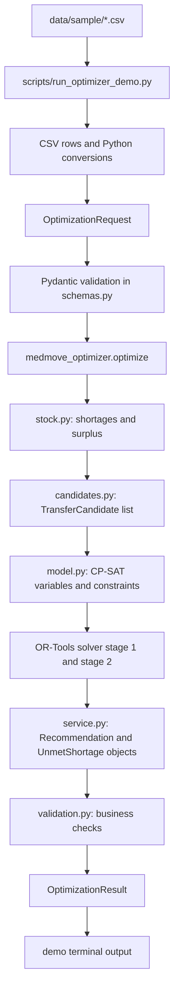

# MedMove Optimizer Explained Simply

This guide explains the code that is actually in this Optimizer project. It is
written for someone who is new to Python, Pydantic, and OR-Tools.

## MedMove Optimizer in Simple Words

MedMove looks at medicine stock in several hospitals and suggests transfers.
It does not physically move medicine. It produces proposals for a backend,
coordinator, or hospital user to review.

The optimizer asks:

1. Which stock is usable?
2. Which hospital-medicine combinations are below target?
3. Which stock can be donated without taking the source below its protected
   level?
4. Is there an active directed route?
5. Will the batch still have enough shelf life when it arrives?
6. Is route capacity available?
7. Is the total cost inside the budget?
8. Which feasible combination best satisfies the objective?

The current conservative donor rule is:

```text
effective_protected_stock = max(target_stock_units, minimum_reserve_units)
transferable_surplus = max(
    usable_stock_units - effective_protected_stock,
    0,
)
```

This means a hospital below target cannot donate that medicine, even if it is
above its minimum reserve.

### Important words

| Word | Simple meaning |
|---|---|
| Inventory | Medicine batches currently recorded at hospitals. |
| Usable stock | Stock from active facilities and medicines, with `ELIGIBLE` quality, not expired on the planning date. |
| Target stock | Desired stock for one hospital and one medicine. |
| Minimum reserve | A lower safety level that should not be crossed. |
| Effective protected stock | The larger of target stock and minimum reserve. |
| Shortage | `max(target_stock_units - usable_stock_units, 0)`. |
| Transferable surplus | Usable stock above effective protected stock. |
| Candidate | One possible source batch, destination, medicine, and route combination. |
| Optimization model | The mathematical rules that limit transfer quantities. |
| Solver | OR-Tools CP-SAT, which searches for the best feasible quantities. |
| Recommendation | A positive transfer line returned for review. |
| Unmet shortage | A shortage line whose remaining shortage is still positive. |
| Optimal | The solver proved that no better solution exists for the implemented model. |

Example:

```text
Usable stock: 500
Target: 300
Minimum reserve: 200
Effective protected stock: max(300, 200) = 300
Transferable surplus: 500 - 300 = 200
```

If another hospital has 20 units and a target of 200, its shortage is 180.
If the route capacity is 100 and the budget only allows 75 units, the most
the optimizer can recommend in that isolated example is 75 units.

## Project structure

The project root contains these important areas:

```text
Optimizer/
├── data/sample/
├── medmove_optimizer/
├── scripts/
├── tests/
├── Project Context/
├── requirements.txt
└── README.md
```

### Application package

| File | What it does | Why it matters |
|---|---|---|
| `medmove_optimizer/__init__.py` | Exports `optimize`, `calculate_shortages`, and `calculate_surpluses`. | Gives the backend one stable public import path. |
| `medmove_optimizer/schemas.py` | Defines all request and result models and enums. | Prevents malformed data from entering or leaving the optimizer. |
| `medmove_optimizer/stock.py` | Calculates usable stock, shortages, protected stock, surplus, and shelf life. | Provides the shared stock rules. |
| `medmove_optimizer/candidates.py` | Builds possible transfers. | Removes impossible source/destination/batch/route combinations before solving. |
| `medmove_optimizer/objectives.py` | Contains small score and cost helpers. | Names the two quantities used by the objective. |
| `medmove_optimizer/model.py` | Builds and solves the CP-SAT model. | Chooses quantities while obeying constraints. |
| `medmove_optimizer/validation.py` | Independently checks recommendations and totals. | Detects invalid results even if a solver returned them. |
| `medmove_optimizer/service.py` | Orchestrates the complete optimization. | This is the implementation of the public `optimize` function. |

### Scripts

| File | What it does |
|---|---|
| `scripts/run_optimizer_demo.py` | Loads the five sample CSVs, builds an `OptimizationRequest`, calls the real optimizer, and prints the result. |
| `scripts/load_sample_csv.py` | Currently empty. It does not participate in the demo or tests. |

### Data

`data/sample/` contains the synthetic input:

| CSV | Current data rows | Main contents |
|---|---:|---|
| `facilities.csv` | 10 | Facility codes, names, locations, and active flags. |
| `medicines.csv` | 4 | Medicine codes, names, strengths, forms, and units. |
| `inventory_batches.csv` | 41 | Batch stock, expiry, quality, facility, and medicine. |
| `facility_medicine_plans.csv` | 40 | Target, reserve, demand, priority, and shelf-life policies. |
| `transport_routes.csv` | 36 | Directed routes, costs, capacities, transit times, and currency. |

The CSV headers are mapped by the demo script into the optimizer schema. For
example, `facility_code` becomes both `FacilityInput.id` and
`FacilityInput.code`; `generic_name` becomes `MedicineInput.name`; and
`quantity_on_hand_units` becomes `InventoryBatchInput.available_quantity_units`.

### Tests and support files

| File or folder | Purpose |
|---|---|
| `tests/conftest.py` | Pytest fixture that loads the five CSVs and builds `valid_request`. It uses `utf-8-sig` and strict boolean parsing. |
| `tests/test_schemas.py` | Tests field validation, references, uniqueness, enums, and result arithmetic. |
| `tests/test_stock.py` | Tests usable stock, shortages, expiry, shelf life, and conservative donor levels. |
| `tests/test_candidates.py` | Tests directed candidate generation and that H06/MED3 cannot donate. |
| `tests/test_model.py` | Tests shared route capacity, budget, and solver score behavior. |
| `tests/test_validation.py` | Checks a real sample result with business validation. |
| `tests/test_service.py` | Tests the public service, the isolated known-answer case, empty candidates, budget limits, warnings, and input immutability. |
| `requirements.txt` | Lists OR-Tools, Pydantic, pandas, and pytest. |
| `README.md` | Present but currently contains no useful project instructions. |
| `Project Context/` | Contains the master context, shared contract, optimizer guide, and agent instructions. |

## Complete data flow

The real execution path used by the demo is:



### Step-by-step mapping

| Step | File | Function | Input | Output | Next step |
|---:|---|---|---|---|---|
| 1 | `data/sample/*.csv` | None | Text rows | CSV records | Demo reads them. |
| 2 | `scripts/run_optimizer_demo.py` | `read_csv` | CSV path | `list[dict[str, str]]` | Conversion code uses each row. |
| 3 | `scripts/run_optimizer_demo.py` | `build_request` | CSV dictionaries | Typed fields and schema objects | Pydantic validates the request. |
| 4 | `schemas.py` | `OptimizationRequest` | Facilities, medicines, batches, policies, routes | Validated request | Service is called. |
| 5 | `service.py` | `optimize` | `OptimizationRequest` | Shortages and candidates | Solver is called. |
| 6 | `stock.py` | `calculate_shortages`, `calculate_surpluses` | Request | Shortage and surplus lines | Candidate generation. |
| 7 | `candidates.py` | `generate_candidates` | Request | `list[TransferCandidate]` | CP-SAT model. |
| 8 | `model.py` | `solve_candidates` | Candidates, budget, time | `SolveResult` | Service converts decisions. |
| 9 | `service.py` | `optimize` | Solver decisions | Recommendations and unmet rows | Result validation. |
| 10 | `validation.py` | `validate_result` | Request and result | Exception or success | Demo prints result. |
| 11 | `scripts/run_optimizer_demo.py` | `print_result` | Request and result | Human-readable terminal output | Process exits. |

## `schemas.py` for beginners

A class is a reusable definition for an object. A Pydantic model is a class
that also checks and converts input data.

For example:

```python
class FacilityInput(SchemaModel):
    id: str = NonEmptyId
    code: str = NonEmptyId
    name: str = NonEmptyId
    is_active: bool
```

This says that a facility has text identifiers and name, plus a Boolean active
flag. `Field(min_length=1)` rejects an empty identifier.

### Enums

Enums restrict a value to a known set:

- `QualityStatus`: `ELIGIBLE`, `QUARANTINED`, `RECALLED`, `DAMAGED`, `EXPIRED`.
- `CurrencyCode`: currently only `INR`.
- `ObjectivePolicy`: currently only `PRIORITY_WEIGHTED_UNITS_THEN_COST`.
- `RunStatus`: `PENDING`, `RUNNING`, `COMPLETED`, `FAILED`.
- `SolverStatus`: `OPTIMAL`, `FEASIBLE`, `INFEASIBLE`, `UNKNOWN`, `MODEL_INVALID`.

`SchemaModel` sets `extra="forbid"`, so an unexpected field is rejected, and
`str_strip_whitespace=True`, so surrounding string whitespace is removed.

### Input models

- `FacilityInput` describes a hospital.
- `MedicineInput` describes a medicine.
- `InventoryBatchInput` describes one stock batch.
- `PolicyInput` describes one facility-medicine target and reserve policy.
- `RouteInput` describes one directed transport route.

The complete request is:

```python
class OptimizationRequest(SchemaModel):
    schema_version: Literal["1.0"]
    run_id: str
    planning_date: date
    horizon_days: int
    budget_minor_units: int
    currency_code: CurrencyCode
    objective_policy: ObjectivePolicy
    facilities: list[FacilityInput]
    medicines: list[MedicineInput]
    inventory_batches: list[InventoryBatchInput]
    facility_medicine_policies: list[PolicyInput]
    routes: list[RouteInput]
    max_solve_seconds: int
```

The request-level validator checks relationships that one row cannot check:

- Facility IDs are unique.
- Medicine IDs are unique.
- Batch IDs and route IDs are unique.
- Policy facility-medicine pairs are unique.
- Batches and policies refer to known facilities and medicines.
- Routes refer to known facilities.
- Route currency matches request currency.

For example, a batch can have a valid-looking `facility_id`, but the request
validator still needs to check that the facility actually exists.

### Output models

`Recommendation` describes one proposed transfer. Its validator checks:

```text
total_cost_minor_units =
quantity_units * unit_cost_minor_units
```

`UnmetShortage` describes a shortage that remains after inbound
recommendations. Its validator checks:

```text
shortage_after_units =
shortage_before_units - recommended_units
```

The service currently emits only records with positive remaining shortage.

`OptimizationSummary` contains cost, budget, transfer-line count, shortage-line
count, fulfilled-shortage count, and priority score.

`OptimizationResult` contains run status, both solver statuses, the
`optimality_proven` flag, recommendations, unmet shortages, warnings, and the
summary. Its validator checks transfer count, cost total, and priority score.

## Stock calculations

### `usable_stock_by_pair`

`stock.py` uses the same definition everywhere:

```python
batch.quality_status is QualityStatus.ELIGIBLE
and batch.expiry_date >= planning_date
```

It also requires an active facility and active medicine. It adds quantities
into a dictionary keyed by `(facility_id, medicine_id)`.

### `calculate_shortages`

For each policy:

```python
shortage = max(0, target_stock_units - usable_stock_units)
```

If usable stock is 70 and target is 80, shortage is 10.

### `protected_stock_units`

The current conservative rule is centralized in one function:

```python
def protected_stock_units(policy: PolicyInput) -> int:
    return max(policy.target_stock_units, policy.minimum_reserve_units)
```

`calculate_surpluses` then computes:

```python
transferable = max(0, usable - protected_stock_units(policy))
```

This avoids contradictory formulas in stock calculation, candidate generation,
and validation.

### `batch_meets_shelf_life`

For a route, arrival is:

```text
planning_date + transit_days
```

The batch must expire no earlier than:

```text
arrival_date + minimum_remaining_shelf_life_days
```

## Candidate generation

`candidates.py` defines the frozen `TransferCandidate` data class. Frozen means
the candidate should not be changed after creation.

`generate_candidates(request)` loops through active directed routes and batches.
It keeps a candidate only when:

1. Source and destination are different and active.
2. The medicine is active.
3. The source has conservative transferable surplus.
4. The destination has a positive shortage.
5. The batch passes quality and shelf-life checks.
6. The route is active and directed from source to destination.

The candidate records:

- Batch and facility identifiers.
- Medicine and route identifiers.
- A batch quantity cap.
- The source transferable cap.
- The destination shortage cap.
- Transit days, cost, route capacity, and priority.

Candidate generation does not choose the final quantity. The solver does that.

## CP-SAT model

`model.py` creates one integer decision variable per candidate:

```python
model.NewIntVar(0, candidate.batch_quantity_units, ...)
```

If a candidate can send at most 70 units, its variable cannot exceed 70.

The model adds these constraints:

1. **Batch availability:** all transfers from one batch cannot exceed its
   quantity.
2. **Source protection:** all outgoing transfers for a source-medicine pair
   cannot exceed its conservative transferable quantity.
3. **Destination shortage:** inbound transfers cannot exceed the initial
   shortage.
4. **Shared route capacity:** all medicines using one route share that route's
   capacity.
5. **Budget:** quantity multiplied by unit cost cannot exceed the budget.

### Two stages

Stage 1 maximizes:

```text
sum(quantity_units * priority_weight)
```

If stage 1 is `OPTIMAL`, the proven score is fixed. Stage 2 minimizes total
transport cost while preserving that score.

Statuses mean:

- `OPTIMAL`: CP-SAT proved the best result.
- `FEASIBLE`: a valid result was found, but optimality was not proved.
- `INFEASIBLE`: no feasible positive allocation exists.
- `UNKNOWN`: CP-SAT could not establish a usable status.
- `MODEL_INVALID`: the model itself is invalid.

The service sets `optimality_proven` only when stage 2 is also proven optimal
after stage 1 was optimal.

## Result construction and validation

`service.py` calls the following sequence:

```python
shortages = calculate_shortages(request)
candidates = generate_candidates(request)
solved = solve_candidates(...)
```

It converts positive solver decisions into `Recommendation` objects. It then
groups inbound quantities by destination and medicine. For each initial
shortage, it calculates:

```text
recommended = min(initial_shortage, inbound_quantity)
remaining = initial_shortage - recommended
```

Only positive remaining shortages are emitted in `unmet_shortages`.

`validation.py` independently checks:

- Facility, medicine, batch, and route references.
- Active facilities and routes.
- Batch/source/medicine consistency.
- Route direction.
- Currency.
- Expiry and shelf life.
- Batch availability.
- Conservative protected source stock.
- Destination shortage.
- Shared route capacity.
- Budget and summary arithmetic.

## Illustrative optimization example

This is a small example, not the current sample dataset.

```text
Source usable stock: 500
Source target: 300
Source minimum reserve: 200
Destination usable stock: 20
Destination target: 200
Route capacity: 100
Cost: 200 paise per unit
Budget: 15,000 paise
```

The effective protected source level is 300, so transferable surplus is 200.
The destination shortage is 180. Route capacity allows 100, but the budget
allows only:

```text
15,000 / 200 = 75 units
```

Therefore, the best possible transfer is 75 units, costing 15,000 paise. The
remaining shortage is 105 units.

The known-answer test in `tests/test_service.py` verifies this through the real
public optimizer interface. It does not put this answer into production code.

## Actual sample-data result

The demo command is:

```powershell
.\.venv\Scripts\python.exe scripts\run_optimizer_demo.py
```

The verified current result is:

```text
Run status: COMPLETED
Stage 1: OPTIMAL
Stage 2: OPTIMAL
Optimality proven: True
Recommendations: 3
Estimated cost: 17,875 paise (INR 178.75)
Original budget: 18,000 paise (INR 180.00)
Remaining budget: 125 paise (INR 1.25)
Unmet-shortage records: 25
Total remaining shortage units: 1,660
```

Current recommendations are:

| Source | Destination | Medicine | Batch | Quantity | Total cost |
|---|---|---|---|---:|---:|
| H06 | H02 | MED2 | `B_H06_MED2_A` | 60 | 11,100 paise |
| H06 | H02 | MED4 | `B_H06_MED4_A` | 15 | 2,775 paise |
| H06 | H05 | MED4 | `B_H06_MED4_A` | 20 | 4,000 paise |

There are 25 records because 25 shortage lines still have a positive remaining
shortage. The total remaining units are 1,660. These are different metrics:
three recommendation records do not mean three units, and 25 shortage records
do not mean 25 units.

An optimal result means CP-SAT proved the best result for the constraints that
the code implemented. It does not prove that every possible real-world policy
has been modeled.

## Tests

Pytest discovers files named `test_*.py` and functions named `test_*`.
`tests/conftest.py` provides the shared `valid_request` fixture. A fixture is
reusable setup code supplied to tests as a function argument.

The current suite contains:

- Schema tests for field and relationship validation.
- Stock tests for eligibility, shortage, expiry, shelf life, and conservative
  donor rules.
- Candidate tests for directed candidates and H06/MED3 donation prevention.
- Model tests for route capacity, budget, and objective score.
- Validation tests for a complete sample result.
- Service tests for the known-answer case, empty candidates, budget limits,
  warnings, and input immutability.

Verified command and result:

```powershell
.\.venv\Scripts\python.exe -m pytest -q
33 passed
```

Passing tests prove that the tested behavior worked for the tested inputs.
They do not prove that every possible data shape or business policy is
correct. The backend should continue to validate database-to-request mapping
and should preserve the shared contract.

## Beginner glossary

- **Import:** `from medmove_optimizer import optimize` loads a function from
  another file.
- **Function:** A named block of reusable code, such as
  `calculate_shortages(request)`.
- **Return value:** The object a function gives back, such as an
  `OptimizationResult`.
- **Class:** A reusable object definition, such as `FacilityInput`.
- **Object:** One instance of a class, such as one facility.
- **List:** An ordered collection, such as `list[RouteInput]`.
- **Dictionary:** Key-value storage, such as stock keyed by
  `(facility_id, medicine_id)`.
- **Enum:** A controlled set of names, such as `SolverStatus.OPTIMAL`.
- **Type hint:** Information such as `request: OptimizationRequest` describing
  the expected type.
- **Pydantic:** The library that validates and converts request/result models.
- **`date`:** Python's calendar-date type used for planning and expiry.
- **`Decimal`:** A number type used for precise policy demand values.
- **`csv.DictReader`:** Reads each CSV row as a dictionary keyed by headers.
- **Comprehension:** Compact construction such as
  `{p.facility_id: p for p in policies}`.
- **Exception:** An error object raised when data or processing is invalid.
- **`try/except`:** The demo uses it to print a useful failure and return a
  nonzero exit code.
- **Pytest fixture:** Reusable test setup, here `valid_request`.
- **Assertion:** A test statement that must be true.
- **CP-SAT variable:** An integer quantity the solver can choose.
- **Constraint:** A rule limiting those variables.
- **Objective:** What the solver tries to maximize or minimize.

## Backend integration boundary

The backend/database adapter should:

1. Read current database records.
2. Map database identifiers to the optimizer's business identifiers.
3. Build and validate an `OptimizationRequest`.
4. Call the existing optimizer.
5. Receive an `OptimizationResult`.
6. Persist the run/result according to the backend contract.
7. Return the appropriate filtered result to the frontend.

The exact public interface is:

```python
from medmove_optimizer import optimize
from medmove_optimizer.schemas import OptimizationRequest, OptimizationResult

def run_optimizer(request: OptimizationRequest) -> OptimizationResult:
    return optimize(request)
```

The optimizer does not import FastAPI, PostgreSQL, authentication, or React.
It does not write to a database, mutate inventory, approve a transfer, or
dispatch a shipment. The backend should reuse it rather than duplicate stock,
candidate, and solver logic.

## Recommended learning order

1. Read **MedMove Optimizer in Simple Words**.
2. Read the folder and file table.
3. Run the demo and inspect its output.
4. Study `OptimizationRequest` in `schemas.py`.
5. Follow `optimize` in `service.py`.
6. Study stock calculations in `stock.py`.
7. Study candidate generation in `candidates.py`.
8. Study CP-SAT constraints in `model.py`.
9. Study `validation.py` and result construction.
10. Read the tests and rerun both commands.

Useful commands:

```powershell
.\.venv\Scripts\python.exe -m pytest -q
```

Runs all tests in the project's virtual environment.

```powershell
.\.venv\Scripts\python.exe scripts\run_optimizer_demo.py
```

Loads the sample CSV data, runs the real optimizer, and prints the actual
recommendations and shortages.

